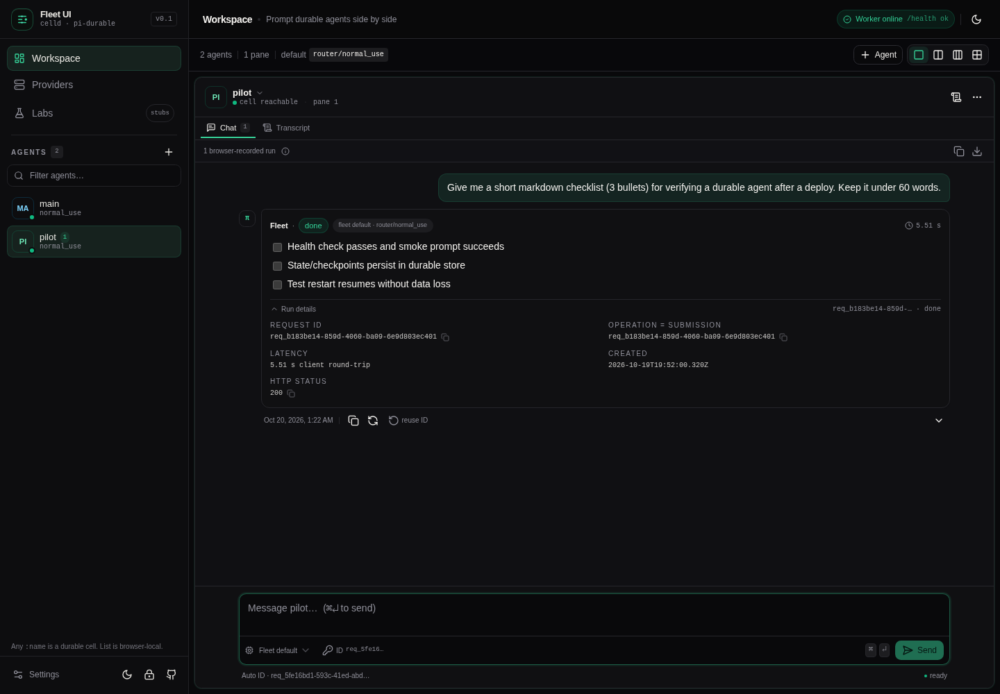

# fleet-ui

[](https://github.com/amangupta20/fleet-ui/actions/workflows/ci.yml)
[](LICENSE)
[](.nvmrc)

A feature-rich, self-hosted web console for **[fleet-base](https://github.com/amangupta20/fleet-base)** — a `celld` + [Pi Durable](https://github.com/badlogic/pi-mono) agent fleet.

> **Scope:** this repository is the **console only**. It does not vendor fleet-base, celld, Worker routes, or Durable Object code. Run the Worker separately and point `FLEET_URL` at it.

**Docs:** [Contributing](CONTRIBUTING.md) · [Security](SECURITY.md) · [Changelog](CHANGELOG.md)

Fleet UI talks to the Worker API through a same-origin proxy, so the fleet never needs CORS headers and `FLEET_URL` never reaches the browser. It ships a production build, Docker image, PWA shell, optional password gate, provider dashboard, durable-transcript viewer, and 1–4 pane workspace.

```text
Browser ── /api/* ──▶ Next.js rewrite ──▶ Node proxy route ──▶ FLEET_URL (celld / fleet node)
                          same origin              runtime env          Worker API
```

> **Status:** v0.1.0, verified against `celld dev` 0.6.2 and fleet-base at port `9876`. Future capabilities are deliberately inert Labs stubs — no fake backend calls.



---

## Contents

- [Features](#features)
- [Quickstart](#quickstart)
- [Architecture](#architecture)
- [Configuration](#configuration)
- [Password gate](#password-gate)
- [Using the console](#using-the-console)
- [Providers dashboard](#providers-dashboard)
- [Multi-pane workspace](#multi-pane-workspace)
- [Feature flags and Labs](#feature-flags-and-labs)
- [PWA, themes, and phones](#pwa-themes-and-phones)
- [Scripts and tests](#scripts-and-tests)
- [Docker](#docker)
- [Deployment notes](#deployment-notes)
- [Security notes](#security-notes)
- [Troubleshooting](#troubleshooting)
- [Roadmap](#roadmap)
- [API assumptions](#api-assumptions)
- [Credits](#credits)
- [Contributing](#contributing)
- [License](#license)

---

## Features

| Area | v1 behavior |
|---|---|
| **Agent rail** | Local agent list (`localStorage`), any Durable Object `:name`, search, add/remove, reachability dots, per-agent model label |
| **Chat** | Prompt composer, browser session log, markdown answers, copy/export, retry, model override, live latency, `status` / `reason`, `requestId` + `submissionId` / `operationId` |
| **Idempotency** | Auto-generated request IDs per send, manual IDs, reuse-last, same-ID retry; copy every ID |
| **Durable transcript** | Tail `GET /agent/:name/messages` with limit selector (10–100), kind/id/preview rendering, refresh, JSON/text export |
| **Reset** | Confirmed `POST /agent/:name/reset`; clears server context and the browser run log for that agent |
| **Providers** | `/models` default, configured flags, catalog search/filter, context + output limits, router base URL and live ids, unpinned-id warning |
| **Workspace** | 1–4 pane layouts, persisted pane assignments, independent composers, mobile pane switcher |
| **Theming** | Light / dark / system via `next-themes`; responsive phone layout |
| **PWA** | Manifest, icons, production service worker, offline fallback page, installable shell |
| **Password gate** | Optional shared password via runtime env, HMAC-signed HttpOnly cookie, login throttle, lock button |
| **Keyboard** | `Cmd/Ctrl + Enter` sends; `Shift + Enter` inserts a newline |
| **Labs** | Ten future-feature stubs behind local flags: terminal, files/diff, harness picker, preview URLs, MCP, skills, queues/runs, vault, node ops, analytics |

No provider keys, passwords, or fleet URLs are compiled into the client bundle.

---

## Quickstart

### Prerequisites

- **Node.js 22.19+** (see `.nvmrc`)
- A running **fleet-base** Worker with at least one provider configured
- `celld` and `esbuild` on `PATH` for the backend

### 1. Start the fleet Worker

```sh
git clone https://github.com/amangupta20/fleet-base.git
cd fleet-base
npm install
cp .env.example .dev.vars
# Configure one provider path in .dev.vars, then:
npm run dev
# ready at http://127.0.0.1:9876
```

Health check: `curl localhost:9876/health` → `ok`.

### 2. Start Fleet UI

```sh
git clone https://github.com/amangupta20/fleet-ui.git
cd fleet-ui
npm install
cp .env.example .env.local       # FLEET_URL=http://127.0.0.1:9876 by default
npm run dev
# open http://localhost:3000
```

On first load the console seeds one browser-local agent named `main` and assigns it to pane 1. Type a prompt (or pick a suggestion) and press **Cmd/Ctrl + Enter**.

Optional password gate for local runs:

```sh
FLEET_UI_PASSWORD='change-me' npm run dev
```

> `FLEET_URL` is read by the Next.js server at request time, not baked into the client. Production builds can change it by restarting with a different value.

---

## Architecture

```text
┌────────────────────────────── Browser ───────────────────────────────┐
│  React 19 + Next.js App Router                                       │
│  ├─ TanStack Query     fleet reads / mutations                      │
│  ├─ Zustand + localStorage  agent rail, panes, flags, session log   │
│  ├─ shadcn/ui + Tailwind    UI system                               │
│  └─ xterm.js           terminal tab stub (flag-gated)               │
└───────────────────────────────┬──────────────────────────────────────┘
                                │ same-origin fetch /api/*
┌───────────────────────────────▼──────────────────────────────────────┐
│  Next.js server (Node runtime)                                       │
│  ├─ rewrite /api/:path* → /fleet-proxy/:path*                       │
│  ├─ fleet-proxy route: optional auth → fetch(`${FLEET_URL}/…`)       │
│  └─ app shell auth gate + /auth/unlock, /auth/lock                  │
└───────────────────────────────┬──────────────────────────────────────┘
                                │ server-to-server (no CORS)
┌───────────────────────────────▼──────────────────────────────────────┐
│  fleet-base Worker (celld dev or a bucket-backed node)               │
│  /health  /models  /agent/:name/{prompt,state,messages,reset}       │
└──────────────────────────────────────────────────────────────────────┘
```

### Repository layout

```text
app/                    App Router pages, unlock flow, auth, /fleet-proxy, manifest
components/             shell, panes, chat, providers, labs, shadcn/ui primitives
hooks/  lib/  stores/   TanStack Query hooks, API/types/utilities, Zustand stores
public/                 PWA icons, sw.js, self-contained offline.html
scripts/smoke.mjs        live end-to-end API smoke test
tests/                   Vitest unit tests
Dockerfile              multi-stage Next.js standalone image
docker-compose.yml      local Fleet UI next to celld (host networking)
```

There is **no backend source in this repo**. `fleet-base` remains its own Worker project; the only server-side code here is the Next.js proxy/auth layer.

### Why an internal proxy route instead of a literal upstream rewrite?

A direct `rewrites()` destination is frozen into the production build. Routing `/api/*` to `/fleet-proxy/*` and resolving `FLEET_URL` inside the Node route handler gives:

- **Runtime configuration** — one Docker image works against any Worker by setting `FLEET_URL` at container start.
- **Centralized auth** — the same password gate protects API calls, not just HTML pages.
- **No CORS dependency** — the browser never contacts the Worker directly.
- **No cookie leakage** — browser cookies are not forwarded upstream; only `content-type` and `accept` are.

The route supports `GET`, `POST`, `HEAD`, and `OPTIONS`, streams the upstream response back, disables caching, and uses a 10-minute upstream timeout (prompts can be slow).

---

## Configuration

### Environment

| Variable | Required | Default | Runtime? | Purpose |
|---|---|---|---|---|
| `FLEET_URL` | Recommended | `http://127.0.0.1:9876` | Yes | Fleet Worker base URL used by the server-side proxy |
| `FLEET_UI_PASSWORD` | No | unset (gate off) | Yes | Enables the shared-password gate; never committed |
| `PORT` | No | `3000` | Yes | Next server port |
| `HOSTNAME` | No | `0.0.0.0` in Docker | Yes | Bind address in standalone mode |

**`.env.example` intentionally contains only `FLEET_URL`.** The password is a secret and is always supplied through the runtime environment, not a committed example file. Copy the example to `.env.local` for local development (already git-ignored).

`FLEET_URL` must be reachable **from the Fleet UI server**, not from the browser. It can be a private address, a tailnet name, or a container service name.

### Provider configuration

Provider keys stay in the Worker's `.dev.vars` / deployment environment. Fleet UI only reads the public `/models` response. At least one of the following must be set in fleet-base for prompts to work:

- own router: `ROUTER_MODEL` and optionally `ROUTER_BASE_URL`, `ROUTER_API_KEY`, `ROUTER_EXTRA_MODELS`
- `OPENCODE_API_KEY` (+ optional `OPENCODE_MODEL`)
- `OPENAI_API_KEY`
- `GEMINI_API_KEY`

If none is configured, `/models` reports `default: null` and Fleet UI shows a configuration warning instead of failing silently.

---

## Password gate

Set `FLEET_UI_PASSWORD` on the Fleet UI server:

```sh
FLEET_UI_PASSWORD='a-long-shared-secret' npm run dev
# or
FLEET_UI_PASSWORD='a-long-shared-secret' npm start
```

What it does:

- Unauthenticated page requests redirect to `/unlock`; public exceptions are `/unlock`, `/auth/*`, `/offline.html`, icons, manifest, and static assets.
- All `/api/*` proxy calls return `401` without a valid session.
- Successful login sets an **HttpOnly, SameSite=Lax, HMAC-signed** cookie (seven days). Set `Secure` automatically when the request is HTTPS (directly or via `X-Forwarded-Proto`).
- Changing the password invalidates every existing session.
- The lock button in the sidebar posts to `/auth/lock` and clears the cookie.
- Login attempts are throttled in-memory (10 per 10 minutes per IP). This is per process and resets on restart; put a real rate limiter or access layer in front for hostile networks.

This is a **single shared secret**, not multi-user authentication or authorization. It is best combined with network isolation (private network, VPN, or an authenticating reverse proxy) and TLS.

See [SECURITY.md](SECURITY.md) for the threat model and reporting process.

---

## Using the console

### Agents

- The rail is browser-local; adding an agent does **not** create a server record.
- A Durable Object is created/activated lazily on the first `prompt` (or first `/messages` read).
- Any `:name` works. Names are trimmed, limited to 64 characters, and cannot contain `/ \ ? #` or control characters. Spaces and unicode are encoded safely.
- The green dot comes from `GET /agent/:name/state`. That endpoint is deliberately coarse: reachable means the binding is addressable, not a true residency probe.
- Removing an agent only removes the shortcut; its Durable Object and transcript remain.

### Chat vs. durable transcript

The **Chat** tab is a browser session log: prompts and full responses are persisted in `localStorage` (`fleet-ui.chat.v1`). It is what enables copy/export and instant history after a reload in the same browser.

The **Transcript** tab fetches the agent's SQLite-backed transcript from the Worker (`GET /agent/:name/messages?limit=…`). That endpoint returns only `{id, kind, preview}` entries with previews capped at 800 characters by the Worker — this UI cannot reconstruct full messages it never received. Both views are labelled accordingly.

**Reset** invokes `POST /agent/:name/reset`, clears the server's active context, and clears the browser log for that agent.

### Request IDs and idempotency

- With **Auto-generate** on (default), each send gets a fresh `req_<uuid>`.
- Use the **ID** control under the composer to edit, copy, or regenerate an ID; toggle auto-generation; or **reuse last**.
- Reusing a request ID with the same prompt returns the same durable operation. The response card shows the same `submissionId`/`operationId`.
- **Reuse ID** on a run restores the prompt, ID, and turns auto-generation off for an exact idempotency test.
- **Retry** restores the prompt with a new ID.
- A `requestId` is sent as `requestId` in the POST body (the Worker also accepts it as `operationId`).

### Model overrides

The model picker in the composer sends `model` as `provider/id` (or omits it to use the fleet default). The Worker pins the agent's session to that model; the override is also stored per agent in this browser. Unconfigured providers are visible but disabled. If the UI is blocked by a stale/unconfigured pin, clear the override or use the fleet default.

### Latency, status, and reason

- **Latency** is the client-measured round trip around the proxied POST, including model time; it is not a server-side metric.
- **Status** is displayed as `done`, `unanswered`, or the raw server value.
- **Reason** is shown verbatim when the Worker returns one. It is the first field to inspect for an `unanswered` run.
- **Run details** lists `requestId`, `submissionId`/`operationId`, latency, creation time, and HTTP status (for request failures).
- Errors preserve the prompt so you can retry without retyping.

### Copy and export

- Copy one response, copy request/operation IDs, copy the whole session log, or export Markdown/JSON.
- The Transcript tab exports the server's preview entries as `.txt`/`.json`.
- Browser history is capped (60 runs per agent, 80k characters per response) to keep localStorage bounded.

---

## Providers dashboard

`/providers` renders `GET /models`:

- Fleet default model and resolved provider.
- Per-provider configured flags (`router`, `opencode-go`, `openai`, `google`).
- Full catalog with context window, max output, readiness, and one-click copy of `provider/id`.
- Router base URL and live ids; if the router exposes ids not pre-registered in the catalog, a warning explains that they need `ROUTER_EXTRA_MODELS` before they can be selected per request.
- Search, provider filters, refresh, and error guidance when the Worker is unreachable.

This page never receives provider API keys.

---

## Multi-pane workspace

- Layout buttons switch between **1, 2, 3, and 4 panes** (3 columns or a 2×2 grid on desktop).
- Assign agents by selecting one in the rail or using an empty pane's picker; each pane has its own header, tabs, composer, request ID, and model selector.
- The same agent may appear in multiple panes (manual assignment); they share the same live run store but have independent composers.
- Layout, pane assignments, and the active pane persist in `localStorage`.
- On phones, only the active pane is shown, with a pane switcher under the toolbar. Navigation collapses into a sheet.
- Inactive panes stay mounted, so an in-flight prompt that finishes while you are in another tab is not lost.

---

## Feature flags and Labs

Open **Labs** from the sidebar. Every flag is off by default, persisted locally, and renders only inert UI. **No future-feature flag triggers a backend request.**

| Flag | Stub surface | What exists | What it would need |
|---|---|---|---|
| `terminal` | Pane tab + Labs | Working xterm.js canvas, local banner, input disabled, no transport | PTY/WebSocket transport, shell sandbox |
| `files` | Pane tab + Labs | Static file tree and diff mock | Node/filesystem API, diff endpoint |
| `harness` | Composer badge + Labs | Disabled “Pi Durable (default)” picker | Multiple harnesses and a selector API |
| `previews` | Labs | Inert URL preview card | Signed preview router |
| `mcp` | Labs | Fake disconnected servers | MCP client + tool discovery |
| `skills` | Labs | Locked skill chips | Skill registry/loading |
| `queues` | Labs | Static scheduled rows | Queue/scheduler endpoints |
| `vault` | Labs | Masked key rows | Encrypted secret store + scoped access |
| `nodeOps` | Labs | Simulated node/lease cards | celld node admin API |
| `analytics` | Labs | Sample bar shape | Durable run metrics and rollups |

Turning on `terminal` or `files` also adds that tab to every agent pane. Turning the flag off falls back to Chat. See **Settings → Reset local workspace** or **Labs → Reset flags** to clear local state.

---

## PWA, themes, and phones

- **Manifest:** served from `/manifest.webmanifest`; icons live in `public/icons/` (192/512/maskable + apple touch).
- **Service worker:** `public/sw.js`, registered **only in production builds**. It caches the offline page and same-origin static assets, uses network-first navigation, and never intercepts `/api/`, `/fleet-proxy/`, `/auth/`, or `/unlock`.
- **Offline:** navigations fall back to `/offline.html`; prompts still require a live Worker.
- **Install:** serve over HTTPS (localhost is exempt), then use “Install app” in the browser. The manifest provides `standalone` display and workspace/providers shortcuts.
- **Themes:** light/dark/system via `next-themes`; no flash-prevention script beyond next-themes. The `<html>` class is set by the provider.
- **Phones:** 390 px layouts are supported; the rail is a sheet, panes switch individually, and the composer remains pinned above the safe area.

Verify PWA behavior with a production build:

```sh
npm run build
FLEET_URL=http://127.0.0.1:9876 npm start
# DevTools → Application → Service Workers / Manifest
```

---

## Scripts and tests

| Command | Purpose |
|---|---|
| `npm run dev` | Next dev server on `:3000` |
| `npm run build` | Production build (type-checked during build) |
| `npm start` | Serve the production build |
| `npm run typecheck` | `tsc --noEmit` with strict + `noUncheckedIndexedAccess` |
| `npm run lint` | ESLint (Next core-web-vitals + TypeScript rules) |
| `npm test` | Vitest unit tests (24 tests) |
| `npm run check` | typecheck + lint + tests |
| `npm run smoke` | Live API smoke test against a running UI |

### Unit tests

```sh
npm run check
```

Covers agent-name validation/encoding, request IDs, formatting, transcript export, auth token signing/expiry/sanitization, and login throttling. Tests do not require a backend.

### Live smoke test

With Fleet UI running (and `FLEET_UI_PASSWORD` if the gate is on):

```sh
node scripts/smoke.mjs --prompt "say hi" --agent smoke-demo --reset

FLEET_UI_URL=http://127.0.0.1:3001 \
FLEET_UI_PASSWORD='...' \
node scripts/smoke.mjs --prompt "say hi" --reset
```

It exercises the same-origin proxy end-to-end: health, models, state, prompt, idempotent re-POST with the same ID, messages, and optional reset.

---

## Docker

The production image is a multi-stage Next.js standalone build. `FLEET_URL` and `FLEET_UI_PASSWORD` are **runtime** environment variables — they are not baked into the image.

```sh
docker build -t fleet-ui .

# Linux: fleet-base listens on 127.0.0.1:9876, so host networking is simplest.
docker run --rm --network host \
  -e FLEET_URL=http://127.0.0.1:9876 \
  -e FLEET_UI_PASSWORD='a-long-shared-secret' \
  fleet-ui
# open http://localhost:3000
```

Or with Compose:

```sh
FLEET_UI_PASSWORD='a-long-shared-secret' docker compose up --build
```

`docker-compose.yml` uses `network_mode: host` deliberately. A bridge-networked container cannot reach a host process bound to `127.0.0.1`. If you prefer bridge networking (or use Docker Desktop), make the Worker reachable from the container, for example:

```sh
docker run --rm -p 3000:3000 --add-host=host.docker.internal:host-gateway \
  -e FLEET_URL=http://host.docker.internal:9876 \
  fleet-ui
```

with celld/the Worker bound to an interface reachable by the container (not only loopback). If the Worker runs in a container on the same Docker network, use its service name instead.

The image runs as a non-root `nextjs` user, exposes `:3000`, and has a healthcheck against the public `/offline.html` page.

---

## Deployment notes

### Self-hosted Node

```sh
npm ci
npm run build
FLEET_URL='http://127.0.0.1:9876' \
FLEET_UI_PASSWORD='...' \
PORT=3000 \
npm start
```

Use a process manager or the provided Docker image, and terminate TLS in front (Caddy, Traefik, nginx). Example Caddy site:

```caddyfile
fleet.example.com {
  encode zstd gzip
  reverse_proxy 127.0.0.1:3000
}
```

Keep the Fleet UI server on the same private network as the Worker when possible. The Worker itself should never be exposed directly to the browser.

### Serverless platforms

Next.js route handlers run on Vercel/other Node hosts, but note:

- The fleet Worker must be reachable from the host (likely public, since the UI server is not on your private network).
- Platform request timeouts may cut off long prompts; the proxy does not stream partial responses.
- PWA service workers require HTTPS.
- Long-lived WebSocket terminal transport (future) will need a different host that supports persistent connections.

Self-hosting next to the fleet is the intended deployment.

### PWA

Serve over HTTPS. The service worker is registered only when `NODE_ENV=production`; `npm run dev` intentionally skips it to avoid stale HMR chunks.

---

## Security notes

- **No secrets in git.** `.env*` is ignored except `.env.example`; `.backend/` (local test copy), `.next/`, `.local-check/`, caches, and coverage are ignored. The example file contains only `FLEET_URL`.
- **Server-only Worker URL.** `FLEET_URL` is never emitted to the client bundle; the browser can only call same-origin `/api/*`.
- **Auth is optional and shared.** `FLEET_UI_PASSWORD` is a single shared secret with in-memory throttling. It is not SSO, per-user authorization, or an audit system. Use network isolation for stronger guarantees.
- **Session cookie.** HttpOnly, SameSite=Lax, Path=/, seven-day expiry, HMAC-SHA256 over an expiry timestamp with a key derived from the password. Changing the password logs everyone out. `Secure` is set when HTTPS is detected directly or via `X-Forwarded-Proto`.
- **Proxy does not forward browser cookies upstream.** Only `content-type` and `accept` are forwarded. The Worker API is unauthenticated by design in fleet-base.
- **Markdown rendering is escaped** by `react-markdown`; this UI does not render raw HTML or use `dangerouslySetInnerHTML`. Links open with `rel="noreferrer noopener"`.
- **localStorage is readable by any script on the origin.** Prompts and full responses are persisted there for the session log. Use **Settings → Clear chat history** / **Reset local workspace** on shared machines.
- **Response headers** include `X-Frame-Options: DENY`, `X-Content-Type-Options: nosniff`, `Referrer-Policy`, and a restrictive `Permissions-Policy`.
- **No CSP is configured.** A strict CSP is recommended for public deployments; Next.js dev overlays and inline scripts make this non-trivial to add generically.
- **The login throttle is per process**, so horizontally scaled deployments need a shared limiter or an upstream auth proxy.

---

## Troubleshooting

| Symptom | Likely cause / fix |
|---|---|
| “Worker offline” everywhere | `FLEET_URL` wrong, `celld dev` not running, or the server cannot reach the Worker. Check `curl $FLEET_URL/health` from the Fleet UI host. |
| `401 Unauthorized` from `/api/*` | `FLEET_UI_PASSWORD` is set and the session cookie is missing/expired. Reload → `/unlock`, or restart without the variable to disable the gate. |
| `/unlock` redirects to `/` | The gate is off (empty/missing `FLEET_UI_PASSWORD`). |
| Models list empty / no provider | Configure one of `ROUTER_MODEL` + `ROUTER_BASE_URL`, `OPENCODE_API_KEY`, `OPENAI_API_KEY`, or `GEMINI_API_KEY` in fleet-base, then restart celld. |
| Prompt fails with 502 | Fleet UI cannot reach the Worker from the server process. In Docker, see the host-networking note above. |
| Prompt takes a long time / 504 | Model latency. The proxy allows 10 minutes; the host/reverse proxy may impose a shorter timeout. |
| PWA not installable / no service worker | Must be a production build served over HTTPS (localhost is exempt); service worker registration is intentionally disabled in dev. |
| Stale UI after deployment | Hard reload; check the service worker update prompt. Bump the `VERSION` in `public/sw.js` when changing shell caching. |
| Agent is “unreachable” but prompts work | `/state` is a coarse reachability indicator; prompts can still succeed. |
| Reused ID shows old run | Expected idempotency when agent + prompt + request ID match. Use **Retry** or a new ID to start a new run. |
| Local state looks wrong | **Settings → Reset local workspace** clears agents, panes, flags, and chat logs. Server state is untouched. |
| Port 3000 in use | `PORT=3001 npm start` or `npm run dev -- --port 3001`; update the URL used for smoke tests. |

---

## Roadmap

### Shipped in v1

- Agent rail with any `:name`, search, reachability, model labels
- Chat with request IDs, model override, latency, status/reason, IDs, copy/export/retry
- Durable transcript viewer with limits and export
- Provider dashboard with catalog, live router discovery, and search
- 1–4 pane workspace, per-pane composers, mobile pane switcher
- Light/dark/system themes, responsive phone layout, PWA shell and offline page
- Optional password gate, lock, throttling, secure headers
- Labs stubs for ten future capabilities
- Docker, Compose, runtime env, MIT license, tests and smoke script

### Next (needs backend work)

- Streaming prompt responses (SSE/WebSocket) and a stop button
- Full message content instead of 800-character previews
- Create/delete agent metadata server-side (today the rail is local-only)
- Prompt history search, pinning, and multi-select export
- Background run queue with persisted in-flight state across reloads
- Server-side latency/token analytics instead of browser-only measurements
- Terminal PTY transport behind the existing flag
- Files/diff API and preview routing
- MCP/skill registries
- Vault-backed per-agent secrets
- Node/lease operations from the UI
- Multi-user auth, roles, audit log, CSP/hardening pass
- Playwright browser test suite and CI against a `celld dev` fixture

### Explicit non-goals for v1

The UI does not add a database, auth provider, queue, or container runtime. Fleet-base remains the source of truth; Fleet UI is a console.

---

## API assumptions

Fleet UI targets the fleet-base Worker API:

| Endpoint | Used for |
|---|---|
| `GET /health` | Worker status chip / connectivity |
| `GET /models` | Default, configured flags, catalog, router live ids |
| `POST /agent/:name/prompt` | Prompt with `{prompt, requestId, model?}` |
| `GET /agent/:name/state` | Rail/pane reachability |
| `GET /agent/:name/messages?limit=` | Durable transcript previews |
| `POST /agent/:name/reset` | Fresh agent context |

The browser only ever requests `/api/*`. Unknown statuses/kinds are rendered defensively rather than assumed. The request ID field accepts letters, numbers, and `. _ : / = -` up to 200 characters.

---

## Contributing

Contributions are welcome. Read [CONTRIBUTING.md](CONTRIBUTING.md) first — it covers the UI-only scope, local backend setup, checks, and the stub policy. Security reports should follow [SECURITY.md](SECURITY.md), not a public issue.

## Credits

Behavior-only references; no code was forked from these projects:

- [hypernewbie/phi](https://github.com/hypernewbie/phi) — tabs, presets, detach-style pane ergonomics
- [getpaseo/paseo — docs/ARCHITECTURE.md](https://github.com/getpaseo/paseo/blob/main/docs/ARCHITECTURE.md) — lifecycle, timeline epochs, provider UX
- [cloudflare/sandbox-sdk — terminal-workspace](https://github.com/cloudflare/sandbox-sdk/tree/main/examples/terminal-workspace) — terminal workspace layout inspiration
- [cloudflare/agents-starter](https://github.com/cloudflare/agents-starter) — app ergonomics reference
- [fleet-base](https://github.com/amangupta20/fleet-base) — the Worker API this console targets
- [shadcn/ui](https://ui.shadcn.com/) — component patterns adapted under the MIT license

---

## License

MIT — see [LICENSE](LICENSE).
