# Screenshots

Every shot is captured against a running fleet-base (`celld dev`) through the
same-origin proxy, with the same browser state seeded so the agent, the pane
and the `submissionId` are identical between shots.

## The change (v0.1 chat bubbles → agent timeline)

Same backend, same agent (`ui-smoke-tool`), same real `submissionId`
(`smoke_1792500534983_5cq3nq`).

| Before | After |
|---|---|
| 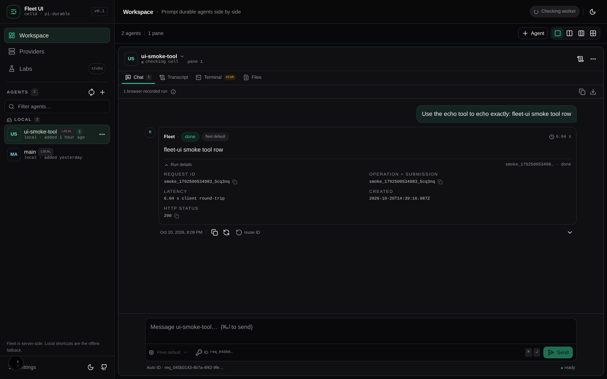 | 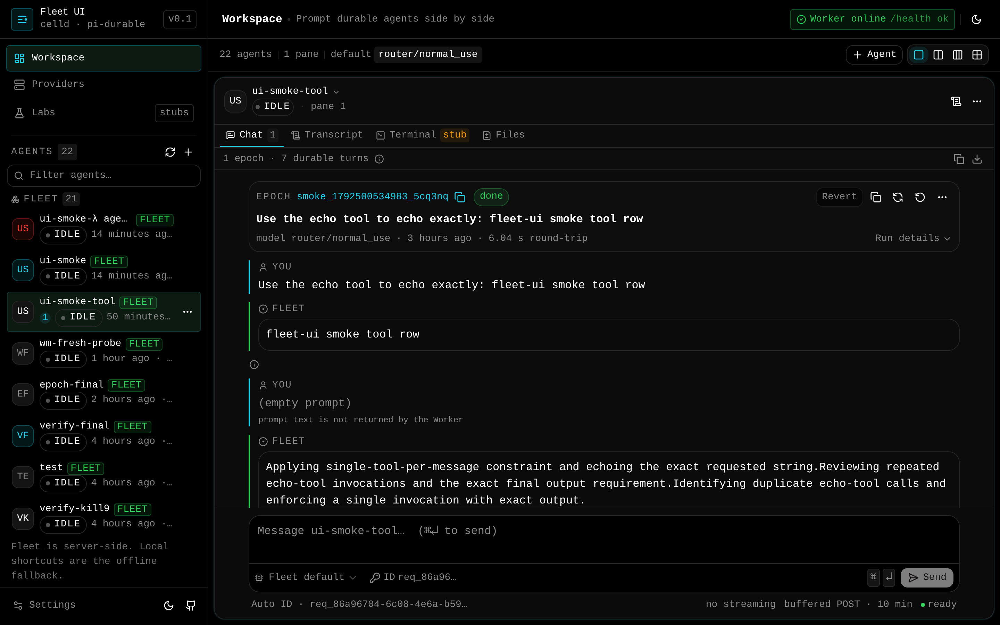 |

The agent rail before and after (reachability dot → lifecycle chip, sans → mono,
pill radii → 4px):

| Before — rail | After — rail |
|---|---|
| 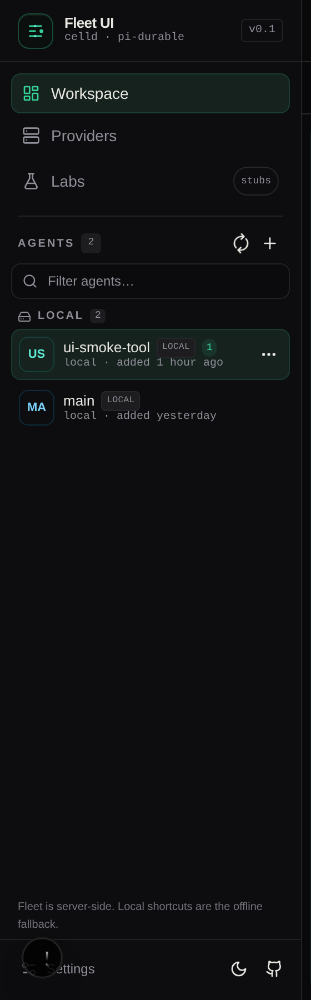 | 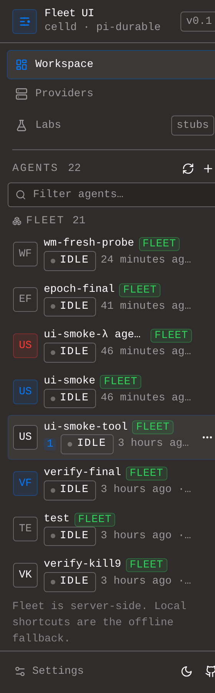 |

| After — epoch timeline with tool rows | After — disabled revert, labelled stub |
|---|---|---|
| 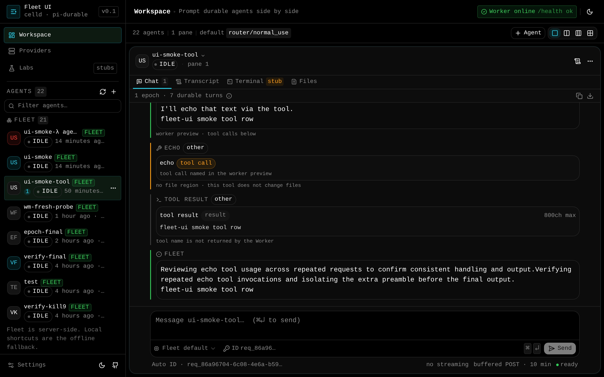 | 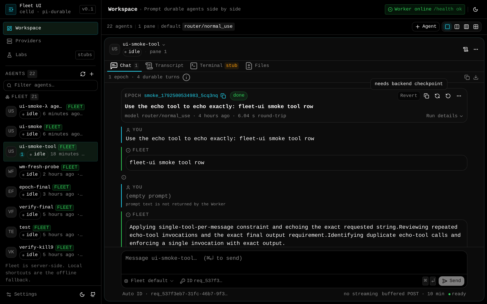 |

| After — lifecycle chip `running` | After — terminal stub |
|---|---|---|
| 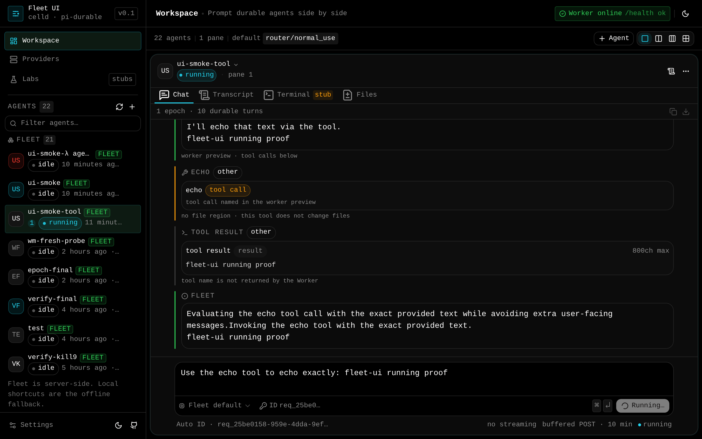 | 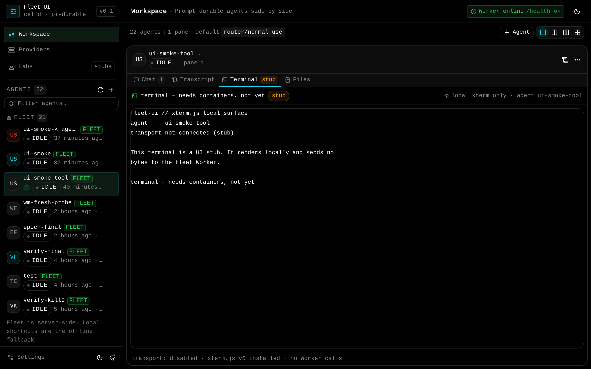 |

The diff region ships wired but empty — it renders real before/after content as
soon as the backend provides a patch, and says so until then:

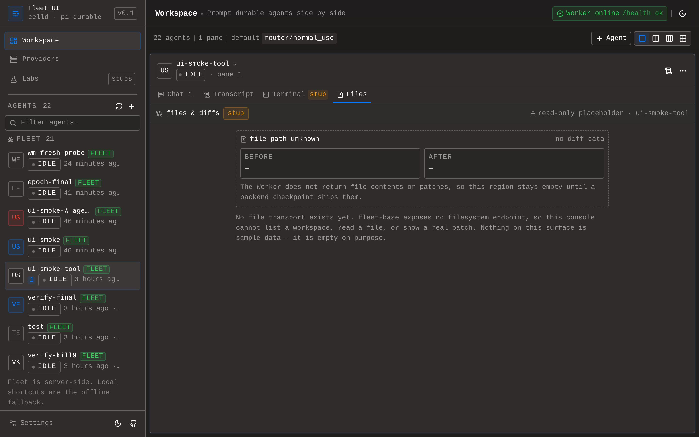

## Theme demos

Three candidate skins for the agent surface, live at `/demo/a`, `/demo/b` and
`/demo/c` in this build. Same console, same agent, same `submissionId`; only
the skin differs (see `app/demo/demo-theme.css`).

| Demo | Canvas | Accent | Cards | Controls | Badges |
|---|---|---|---|---|---|
| **a** | pure black | emerald only | 12px | 10px | pill |
| **b** | pure black | emerald (fleet/success/selected) + cyan (interactive/links/user rows) | 12px | 10px | pill |
| **c** | pure black | emerald + cyan | 16px | 10px | pill |

| a | b | c |
|---|---|---|
| 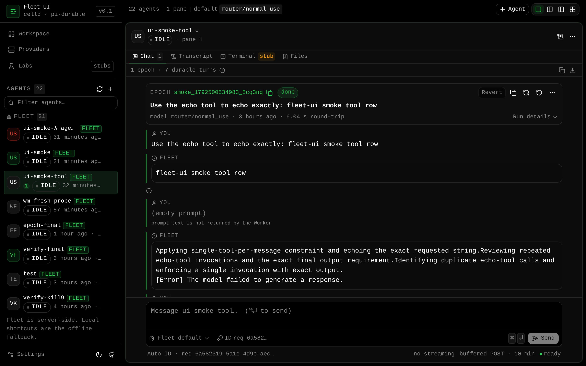 | 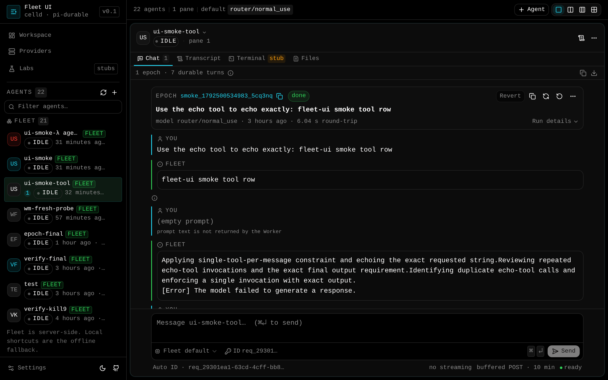 |  |
| 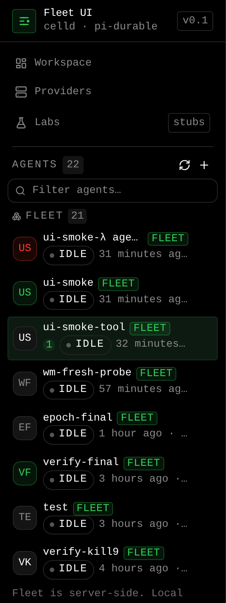 | 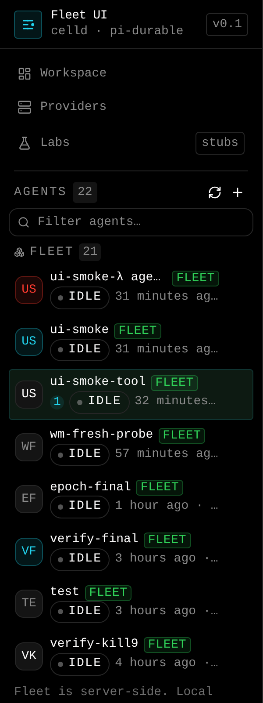 |  |

The pick and the deviations are recorded in
[`../design-system.md`](../design-system.md).
